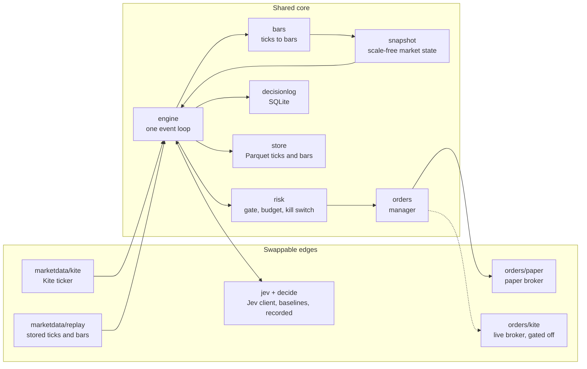
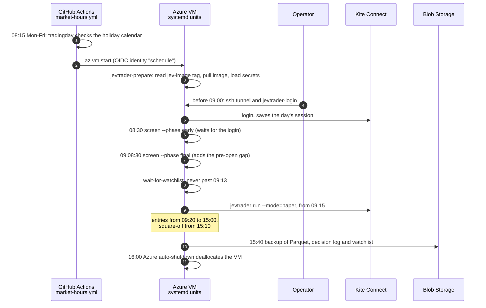
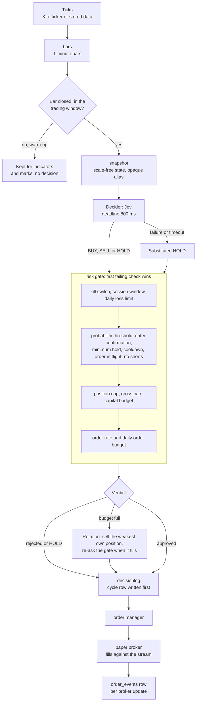
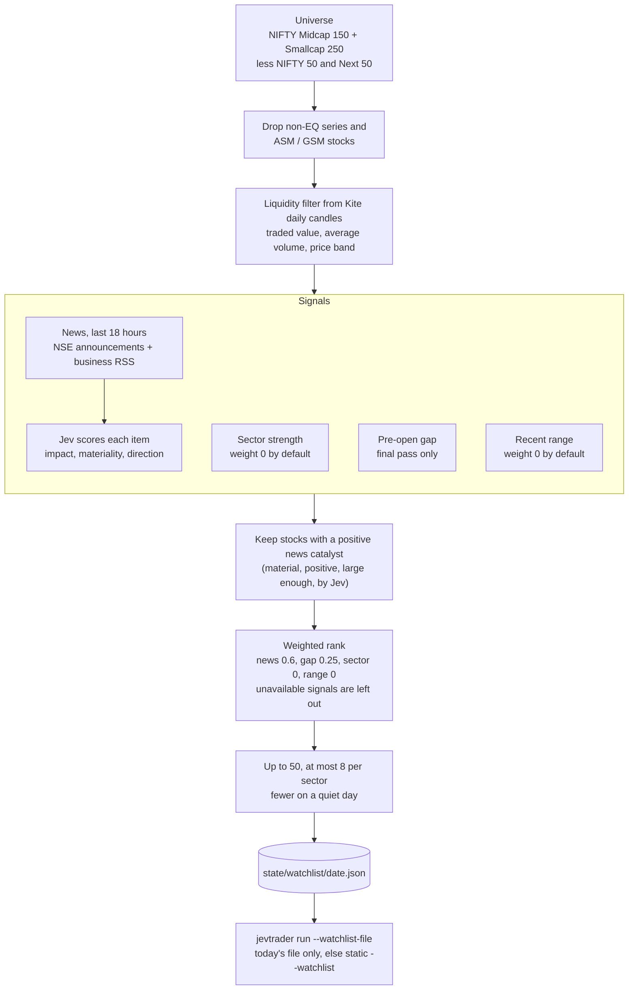
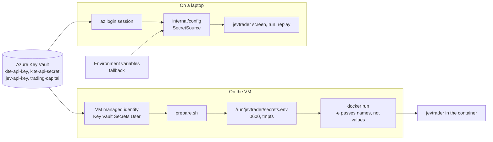
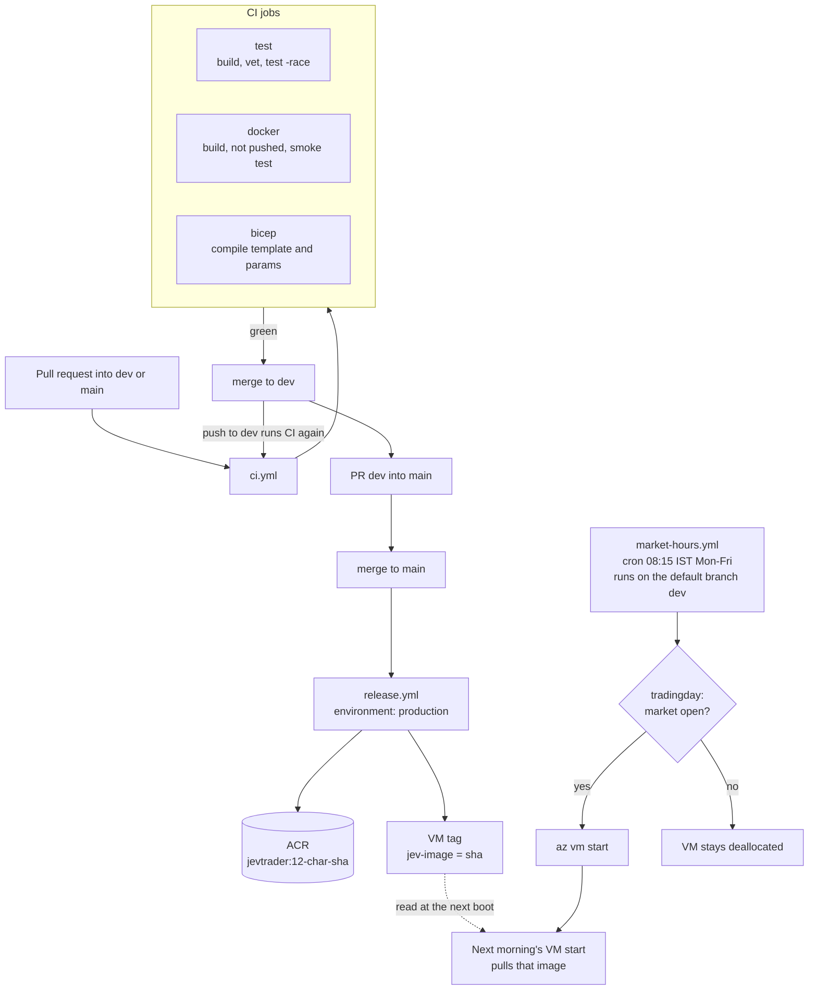
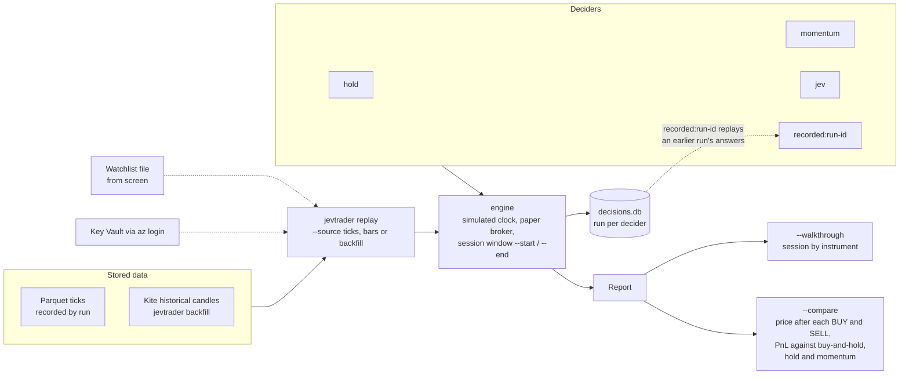
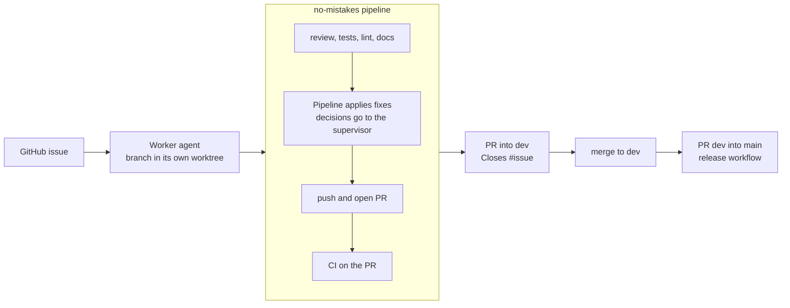

# Architecture

jev-trader is a realtime NSE trading system written in Go. It reads Zerodha Kite market data, asks the Jev model for a decision on each closed bar, and passes every answer through a deterministic risk gate before an order can exist. Today it **paper trades only**: `--mode=live` cannot place orders ([docs/run-and-replay.md](docs/run-and-replay.md)). One binary, `jevtrader`, has the subcommands `login`, `screen`, `run`, `replay`, `backfill`, `shadow-report` and `version`; a second small command, `tradingday`, tells the scheduled workflow whether the NSE is open.

This page is the map. The decisions behind it are in the reports, which it links rather than repeats:

| Report | Topic |
| --- | --- |
| [0001](reports/0001-language.md) | Why Go |
| [0002](reports/0002-architecture.md) | Package boundaries and the shared code path |
| [0003](reports/0003-deployment.md) | The Azure deployment design |
| [0004](reports/0004-watchlist.md) | The pre-market watchlist |

Operating detail lives in [deploy/README.md](deploy/README.md) (Azure setup and the daily runbook), [docs/run-and-replay.md](docs/run-and-replay.md) (`screen`, `run`, `replay`) and [docs/kite-auth.md](docs/kite-auth.md) (the Kite login).

- [System overview](#system-overview)
- [The trading day on Azure](#the-trading-day-on-azure)
- [The decision loop](#the-decision-loop)
- [The pre-market picker](#the-pre-market-picker)
- [Secrets and configuration](#secrets-and-configuration)
- [CI/CD](#cicd)
- [Local replay and comparison](#local-replay-and-comparison)
- [Development workflow](#development-workflow)

## System overview

`run` and `replay` build the **same engine** (`internal/engine`) from different edges: only the market-data source, the clock, the decider and the broker differ. Packages never reach across those edges, which is what lets a replay exercise the real risk gate and order manager.

| Package | Responsibility |
| --- | --- |
| `cmd/jevtrader` | The CLI: flag parsing and wiring of each subcommand. |
| `cmd/tradingday` | Answers "does the NSE trade on this date?" from `deploy/nse-holidays.yaml`; used by the market-hours workflow. |
| `internal/domain` | Shared types: ticks, bars, instruments, decisions, orders. |
| `internal/marketdata` | The `Source` interface. `kite` is the live ticker; `replay` serves stored data. |
| `internal/store` | On-disk Parquet formats for ticks and bars (the contract with Python analysis). |
| `internal/bars` | Builds 1-minute bars from ticks and derived intervals from those. |
| `internal/snapshot` | The versioned JSON state sent to Jev. It carries no date, time of day, ticker or absolute price, so backtests stay leakage-safe. |
| `internal/jev`, `internal/decide` | The Jev API client, and the `Decider` interface with its implementations: Jev, `hold`, `momentum` and `recorded:<run-id>`. |
| `internal/risk` | The deterministic gate: the only package that can mint the `Approval` the order manager requires. It also emits risk-driven exits and owns the kill switch and the capital budget. |
| `internal/orders` | The order manager and the `Broker` interface; `paper` fills against the market-data stream, `kite` is the live broker that refuses while live trading is not approved in code. |
| `internal/engine` | The single event loop that composes all of the above, including own-position rotation. |
| `internal/decisionlog` | Append-only SQLite log of every cycle and order event; also the source for `recorded:` replays. It also holds the shadow signals of every candidate, traded or not, and their outcomes. |
| `internal/shadow` | Fills the shadow signals' outcomes at fixed horizons from the recorded bars and summarises them (`jevtrader shadow-report`). |
| `internal/clock` | Wall clock for `run`, simulated clock for `replay`. |
| `internal/replay` | The replay runner, its report, the instrument-by-instrument walkthrough and the market comparison. |
| `internal/screen`, `internal/universe`, `internal/news`, `internal/watchlist` | The pre-market picker: universe, news sources, signals and ranking, and the watchlist file format. |
| `internal/kiteauth` | The daily Kite login and the saved session. |
| `internal/config` | Secrets (redacted `Secret` type), the Key Vault reader and the capital budget. |
| `internal/nsecal` | The NSE holiday calendar. |

Infrastructure is in `infra/main.bicep`; the scripts and systemd units that run on the VM are in `deploy/vm/`.

## The trading day on Azure

One Ubuntu VM in Central India is started on NSE trading mornings and deallocated by Azure at 16:00 IST ([report 0003](reports/0003-deployment.md)). All times are IST.

The units, in the order they matter:

| Unit | When | What it does |
| --- | --- | --- |
| `market-hours.yml` | 08:15 Mon–Fri (02:45 UTC) | Skips weekends and NSE holidays, then `az vm start`. A manual run with `force` starts the VM on a closed day. |
| `jevtrader-prepare` | every boot | Reads the VM's `jev-image` tag from the instance metadata service, pulls that image from ACR with the managed identity, writes the secrets to a `0600` file on tmpfs. Retries every 30 seconds. |
| `jevtrader-login` | by hand, before 09:00 | Prints the Kite login URL; the SSH tunnel carries Kite's redirect to the listener on the VM. |
| `jevtrader-screen-early.timer` | 08:30 | `screen --phase early`: news and the previous session. Waits for the login. |
| `jevtrader-screen-final.timer` | 09:08:30 | `screen --phase final`: adds the pre-open gap. |
| `jevtrader-run` | after prepare and login | Waits for a valid Kite session, then for the final watchlist but never past 09:13, then `jevtrader run --mode=paper`. Restarts every 30 seconds on failure. |
| `jevtrader-backup.timer` | 15:40 | Parquet files, a consistent SQLite `.backup` of the decision log and the day's watchlist go to Blob Storage. |
| Azure auto-shutdown | 16:00 | Deallocates the VM. Nothing in GitHub stops it. |

If nobody logs in, nothing trades and the VM is still deallocated at 16:00. The risk gate's own limits for the session are in [The decision loop](#the-decision-loop).

## The decision loop

Every closed bar of a watched instrument that falls on the decision cadence (every fifth minute by default, `--decide-every`) starts one decision cycle. A single goroutine owns all mutable trading state; deciders run in their own goroutines and return their answers on a channel.

Points the diagram compresses:

- **Every signal is shadow-logged.** Beside each cycle row `run` writes a `shadow_signals` row (and one per picker entry at the start of the day), whether or not the gate let it trade. `shadow-report` fills what the market did at +15m, +60m, the window end and the day close from the recorded bars. See [docs/run-and-replay.md](docs/run-and-replay.md#the-shadow-log-and-jevtrader-shadow-report).
- **The log comes before the order.** The cycle row (snapshot, answer, verdict, intent) is written before any order is submitted; an `order_events` row follows each broker update.
- **Risk exits do not wait for a decider.** The per-position stop (2% below the average price by default), the optional time exit, the square-off, the daily loss limit and the kill switch produce exits on every tick or bar, logged as cycles of their own with the numbers behind them. The stop and the time exit sell one position; the other three flatten the book.
- **Trade for hours.** The defaults hold a position for at least an hour, wait an hour before re-entering a stock, and enter only on a call of at least 0.70 repeated on two consecutive decisions, five minutes apart. The stop, the time exit, the square-off and the kill switch are never delayed by any of it. See [docs/run-and-replay.md](docs/run-and-replay.md#trading-for-hours).
- **The default session limits** (`risk.DefaultLimits`): no entries before 09:20 or at and after 15:00, and every position flattened from 15:10.
- **Budget and sizing.** The bot trades within a total rupee budget (₹25,000 unless configured) that the gate enforces on every order, sized in buckets S, M and L. See [Secrets and configuration](#secrets-and-configuration) for where the number comes from and [docs/run-and-replay.md](docs/run-and-replay.md#capital-budget) for the rules.
- **Rotation.** When the budget is full, the gate may sell one of the bot's *own* positions to make room. The entry waits up to two minutes for that sale to fill, then goes back to the gate; a stale one is logged as `rotation_abandoned`. Positions the bot did not open are never sold.
- **Kill switch.** A `KILL` file in the state directory, `SIGUSR1`, too many consecutive broker rejections, or a refused order IP trips it.
- **Failures are HOLDs.** Any decider error or timeout becomes a HOLD, counted separately in the run's stats.

## The pre-market picker

`jevtrader screen` builds the day's watchlist in two passes and writes `state/watchlist/<date>.json`. Sources, weights and limits are in [report 0004](reports/0004-watchlist.md) and [docs/run-and-replay.md](docs/run-and-replay.md#jevtrader-screen).

- **Two passes.** `early` runs at 08:30 on news and the previous session; `final` runs at 09:08:30 and adds the pre-open gap and sectoral indices (`final=true` in the file). An early pass never replaces a final file unless `--force`. Daily candles and Jev's news scores are cached for the day, so the second pass is short.
- **A past `--date`** uses the `historic` phase: no pre-open exists and only NSE filings supply news.
- **The fallback is deliberate.** Whatever the screen does, `run` starts (on a quiet day with an empty list it idles rather than trading the static list). If the file is missing, stale or unreadable, it trades the static `watchlist` from the deployment parameters, and it refuses to start only when it has neither.
- **Needs** a Kite session and `KITE_API_KEY`; without `JEV_API_KEY` the news is fetched but not scored.

## Secrets and configuration

No secret lives in GitHub, in the image or in the repository. Key Vault holds the credentials, and each place that runs the code reads them with its own identity.

- **On the VM,** `prepare.sh` uses the VM's managed identity to read the secrets and writes them to a `0600` file on tmpfs. systemd loads that as an `EnvironmentFile`, and the scripts pass variables into the container by name.
- **Locally,** setting `JEVTRADER_KEYVAULT` to the vault name makes the commands read the same secrets through the `az` CLI and your own `az login`. The environment is the fallback, and when the variable is unset secrets come from the environment alone. `config.Secret` prints as `[redacted]` in logs, JSON and formatted output.
- **The capital budget** is the Key Vault secret `trading-capital`, read like the others but treated as configuration, not a credential: it is logged. Order of precedence: the `--capital` flag, then Key Vault, then `JEVTRADER_TRADING_CAPITAL`, then the ₹25,000 default. Changing it needs no deploy; it applies at the next start.
- **GitHub holds identifiers only** (tenant, subscription, resource names, client ids). The two workflow identities use OIDC federated credentials with no client secret, and CI has no right to change infrastructure.
- **Kite session.** The access token comes from the daily `login`, not from Key Vault ([docs/kite-auth.md](docs/kite-auth.md)).

## CI/CD

Three workflows in `.github/workflows/`. The deploy action is only a tag: a merge never disturbs a running session.

- **CI** runs on every pull request into `dev` and `main` and on pushes to `dev`. It needs no secrets, and superseded runs on the same ref are cancelled.
- **Release** builds the image once, pushes it to ACR as `jevtrader:<12-char-sha>` and sets the VM tag `jev-image=<sha>`; the VM never reads a moving tag. **Rollback** is a manual run of the workflow with `rollback_sha` set to an earlier tag; it skips the build.
- **Market hours** checks the holiday calendar with `cmd/tradingday` (a manual `force` overrides it), then starts the VM. Azure auto-shutdown handles the stop.
- **Both Azure workflows skip with a notice and stay green** until the repository variables from the [setup guide](deploy/README.md) exist.
- **Two OIDC identities, one per environment:** `production` may push to ACR and tag the VM; `market-hours` may only read, start and deallocate it.

## Local replay and comparison

`jevtrader replay` runs the real engine, risk gate and paper broker over stored market data with a simulated clock, and reports each run against baselines. It is how a change is tested without waiting for a trading day.

- **Sources.** `ticks` replays recorded ticks, `bars` builds bars from them, and `backfill` uses Kite historical candles that `jevtrader backfill` stored.
- **Deciders.** The default is `hold,momentum`. `jev` calls the live model, so its answers may already know the past; a `recorded:<run-id>` decider re-answers from an earlier run's stored decisions, so everything except the model can be retested. The look-ahead risk is covered in [report 0002](reports/0002-architecture.md).
- **Session window.** `--start` and `--end` limit trading to part of the day. Earlier bars still warm the indicators up, and later data is used only for the comparison.
- **`--compare`** adds the price a few minutes after each BUY and SELL (`--lookahead`, default 5m, 15m, 30m) and the PnL against buy-and-hold and the hold and momentum baselines, which it replays too. **`--walkthrough`** narrates the session instrument by instrument.
- **`--watchlist-file`** replays only the instruments a `screen` run picked.
- **The capital budget** applies as in `run`; `--capital` overrides it for the replay.

## Development workflow

Work moves from an issue to `dev` through a worker and the `no-mistakes` pipeline, then reaches `main` as a reviewed release.

- **Branches.** `dev` is the default branch and where work lands; `main` is what gets released. Every change goes through a pull request, and CI is the same `ci.yml` described above.
- **Issue to PR.** A worker builds one issue on its own branch. `no-mistakes` reviews the diff, runs tests, lint and docs checks, applies the fixes itself and opens the PR; findings that need a human decision are escalated rather than answered by the worker.
- **Release.** Merging `dev` into `main` runs [the release workflow](#cicd), which takes effect at the next VM start.
- **Before pushing,** the same checks CI runs can be run locally: `go build ./... && go vet ./... && go test -race ./...`.
