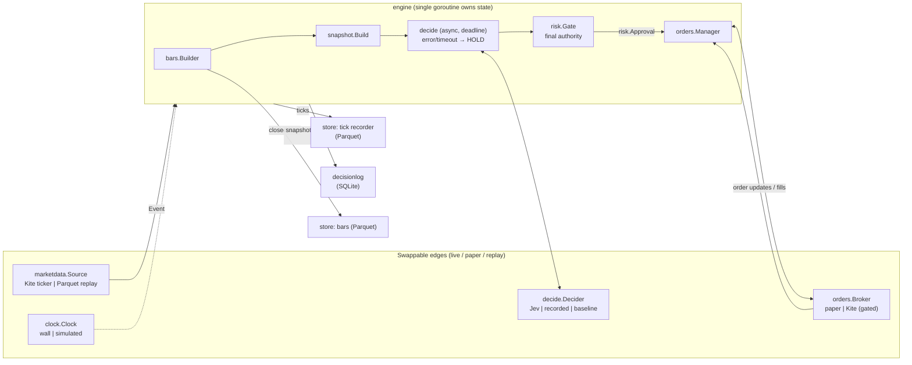
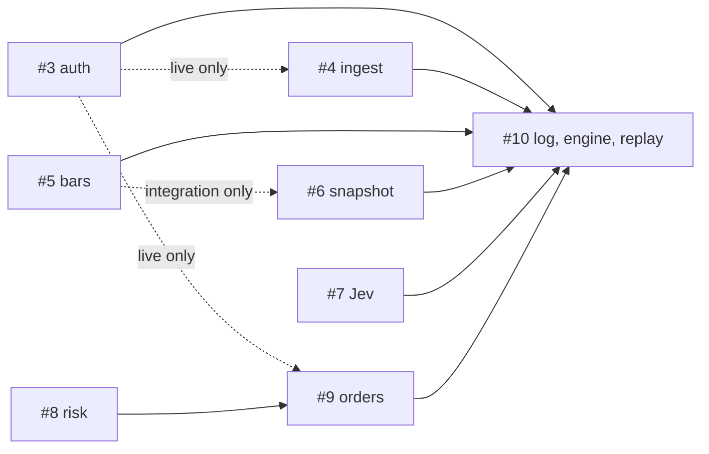

# 0002 — System architecture and component boundaries

- **Status:** Accepted
- **Date:** 2026-10-02
- **Issue:** [#2](https://github.com/sanjeev2040/jev-trader/issues/2)
- **Depends on:** [0001 — Implementation language](0001-language.md) (Accepted: Go)
- **Decider:** repository owner

## Context

jev-trader is a realtime NSE trading system written in Go ([0001](0001-language.md)). The pipeline is:

**ingest → bar builder → state snapshot → Jev decision → deterministic risk gate → order manager (paper/live)**

A decision log records every step. A replay/backtest harness drives the same path from recorded data.

Issues #3–#10 build the components. This report fixes the boundaries between them so they can be built in parallel and still fit together. It covers:

- the package layout;
- the interfaces that let live, paper and replay share one code path;
- the in-process data flow;
- storage;
- secrets;
- the Kite constraints that shape the design;
- the look-ahead risk of backtesting a model that may already know the past.

The facts the design rests on are below. Kite facts were checked against the Kite Connect docs and Zerodha's developer forum on 2026-10-02.

- **Jev** is one HTTP endpoint (`POST /v1/systemone`). It takes `{state, model, questions}` and returns typed answers. A `choice` answer carries the chosen option, per-option `probabilities` and a `confidence`. Errors include 401, 422, 429 (back off) and 529 (overloaded). The quoted end-to-end latency is 70–500 ms. The docs make no promise of determinism and do not state a training-data cutoff ([API reference](https://docs.typesafe.ai/api.md)).
- **Kite session:** login is a manual browser flow that returns a `request_token`. The service exchanges it, with a SHA-256 checksum of `api_key + request_token + api_secret`, for an `access_token`. That token expires **at 6 AM the next day** (a regulatory requirement), or earlier on logout or a master logout ([user docs](https://kite.trade/docs/connect/v3/user/)).
- **Static IP:** since 2026-04-01, SEBI's retail-algo rules require order calls to come from an IP registered in the Kite developer console. Calls from any other IP are rejected. WebSocket data, order book, positions and the other endpoints work from any IP ([Kite forum](https://kite.trade/forum/discussion/15912/preparing-to-comply-with-sebis-retail-algo-rules-static-ip-ratelimits-order-types)).
- **Market orders** now need non-zero market protection. Orders with protection `0`, including SL-M, are rejected.
- **Rate limits** ([docs](https://kite.trade/docs/connect/v3/exceptions/)):
  - quote: 1 req/s;
  - historical: 3 req/s;
  - orders: 10 req/s, 400/min and 5,000/day per user;
  - other endpoints: 10 req/s;
  - at most 25 modifications per order.
- **WebSocket:** 3 connections × 3,000 instruments ([docs](https://kite.trade/docs/connect/v3/websocket/)).

## Decision drivers

1. **One code path.** Replay, paper and live must run the same bar → snapshot → decide → risk → order code. Only the edges may differ: the market-data source, the broker, the clock and the decider. A backtest that runs different code proves nothing about live behaviour.
2. **The risk gate has final authority.** No order reaches a broker unless the deterministic gate approved it. Jev failures, timeouts and malformed answers become HOLD.
3. **Safe by default.** Paper is the default mode. Live trading needs explicit, separate approval (#9). Secrets never enter the repository or the logs.
4. **Parallel build.** Each of issues #3–#10 owns a package with a narrow contract defined here, so most of them can be built and tested against fixtures at the same time.
5. **Simple operations.** One Go binary on one small VM, with local files for storage. A server-based database is added only if it earns its keep.
6. **Auditability.** Every decision can be traced: the snapshot sent, Jev's raw answer, the risk verdict, the order and the fill.

## Architecture

One process, `jevtrader`, has these subcommands:

- `login`: daily Kite login.
- `record`: ingest and persist ticks only, with no trading.
- `run`: trading, in paper or live mode.
- `replay`: a backtest over stored data.
- `backfill`: fetch historical candles over REST.
- `screen`: write the day's watchlist before the session ([0004](0004-watchlist.md)); `run` and `replay` can read it.

All of them build the same `engine` from different parts.



### Package layout

The module is `github.com/sanjeev2040/jev-trader`. Everything except `cmd/` lives under `internal/`, so no package becomes a public API by accident.

| Package | Responsibility |
| --- | --- |
| `cmd/jevtrader` | CLI entry point and subcommands. Wires config into the engine. |
| `internal/domain` | Small shared value types: `Instrument`, `Tick`, `Bar`, `Action`, `Decision`, `DecideError`, `OrderIntent`, `OrderUpdate`, `Fill`, `Position`. No logic and no imports beyond the standard library. |
| `internal/config` | Loads non-secret YAML config and secrets from the environment. Validates both. |
| `internal/clock` | `Clock` interface (`Now`, `After`), with a wall clock and a simulated clock. Session calendar in Asia/Kolkata. |
| `internal/kiteauth` | Login flow, token exchange, the token store and the expiry check (#3). |
| `internal/marketdata` | `Source` interface and `Event` type. `marketdata/kite` (KiteTicker adapter and instrument master) and `marketdata/replay` (reads stored ticks or bars) (#4, #10). |
| `internal/bars` | Pure tick-to-OHLCV aggregation into 1m and 5m bars, closed by event time (#5). |
| `internal/store` | Parquet writers and readers for ticks and bars. Owns the Parquet schemas (#4, #5). |
| `internal/snapshot` | Versioned Jev state schema, and builds it from bars, position and session time (#6). |
| `internal/jev` | Typed HTTP client for `/v1/systemone`: questions, parsing, timeouts and retry budget (#7). |
| `internal/decide` | `Decider` interface, the HOLD-on-failure wrapper, and baseline deciders (#7, #10). |
| `internal/risk` | Deterministic gate, kill switch, square-off scheduler. Mints `risk.Approval` (#8). |
| `internal/orders` | Order manager, the `Broker` interface, `orders/paper` and `orders/kite` (#9). |
| `internal/decisionlog` | Append-only record of every decision cycle and its order events in SQLite. Can replay recorded answers (#10). |
| `internal/engine` | The event loop that composes all of the above, shared by `run` and `replay` (#10). |
| `internal/replay` | Backtest driver and evaluation report against baselines (#10). |

**Import rule:** packages lower in the table may import `domain`, `clock` and `config`, plus the specific upstream packages named in [Component specs](#component-specs). Only `engine` and `cmd` import everything. This keeps the dependency graph acyclic and each package testable on its own.

### Shared interfaces

These four interfaces are the only places where live, paper and replay differ.

```go
// marketdata
type Event struct { Tick *domain.Tick; Bar *domain.Bar } // exactly one is set
type Source interface {
    Run(ctx context.Context, out chan<- Event) error // closes nothing; returns when ctx ends or the data is exhausted
}

// clock
type Clock interface {
    Now() time.Time
    After(d time.Duration) <-chan time.Time
}

// decide
type Decider interface {
    Decide(ctx context.Context, state json.RawMessage) (domain.Decision, error) // encoded snapshot.Snapshot
}

// orders
type Broker interface {
    Place(ctx context.Context, o domain.OrderIntent) (brokerID string, err error)
    Cancel(ctx context.Context, brokerID string) error
    Updates() <-chan domain.OrderUpdate // acks, rejections, partial and full fills
}
```

| Mode | Source | Clock | Decider | Broker |
| --- | --- | --- | --- | --- |
| `run --mode=paper` | Kite ticker | wall | Jev | paper |
| `run --mode=live` | Kite ticker | wall | Jev | Kite (gated) |
| `replay` (model eval) | Parquet ticks or bars | simulated | Jev | paper |
| `replay` (regression) | Parquet ticks or bars | simulated | recorded answers from the decision log | paper |
| `replay` (baseline) | Parquet ticks or bars | simulated | baseline (always-HOLD, simple momentum) | paper |

Paper mode and backtests use the same paper broker. A backtest is then exactly "paper trading on recorded data".

### Data flow and in-process messaging

There is no external message bus. Components talk over Go channels inside one process, and one goroutine, the **engine loop**, owns all mutable trading state: bar builders, positions, open orders and risk counters. Because nothing else touches that state, it needs no locks, and the order of events in a replay matches the order of events in the log.

1. **Ingest.** The Kite adapter's `OnTick` callback converts packets into `domain.Tick`s and sends them on a buffered channel. The WebSocket reader must never block. If the channel is full, the tick is dropped and a drop counter is incremented and alerted on. A drop is a defect to fix, not a normal state.
2. **Tee.** The engine forwards each tick to the **recorder** goroutine on its own buffered channel. The recorder writes ticks to Parquet, so recording is off the decision path.
3. **Bars.** The engine feeds ticks to `bars.Builder`. A bar closes when the event time passes its end. The clock also triggers a close after a short grace period, so illiquid symbols still close on time. Closed bars go to the bar store and to step 4.
4. **Snapshot and decide.** On a bar close (default: 1m) for an instrument with no decision in flight, the engine builds a `snapshot.Snapshot` and encodes it to JSON. It then starts one goroutine that calls `Decider.Decide` with a per-call deadline (default 800 ms, configurable). A semaphore caps concurrent Jev calls (default 8). The result returns to the engine on a results channel.
5. **Risk.** The engine passes each `Decision` to `risk.Gate.Evaluate` with the current book and the time. The gate returns a verdict. If an order is warranted, the verdict carries a `risk.Approval`.
6. **Orders.** The engine passes approvals to `orders.Manager.Submit`. Broker `Updates()` flow back into the engine loop and update positions. Positions feed the risk book and the next snapshot.
7. **Log.** The engine writes one cycle record per decision cycle or risk-driven exit synchronously, *before* it submits any order: the snapshot, the raw Jev answer (or the exit reason), latency, verdict and intent. A crash after the write can then be reconciled; a crash before it leaves nothing to reconcile. SQLite WAL inserts take about a millisecond, far inside a 1-minute bar.

**Replay difference.** In live trading the engine keeps consuming ticks while Jev answers. In replay it stops reading the source until in-flight decisions resolve, so the simulated clock cannot run ahead of the decision. The answer is then applied at simulated time `bar_close + latency`, where latency is the measured or recorded Jev latency. The order fills against the first event after that time. This one flag (`WaitForDecisions`) is the only behavioural difference between the two paths. It exists so a slow or fast backtest machine cannot change the result.

## Component specs

**`kiteauth` (#3).**
- `jevtrader login` starts a listener on `127.0.0.1` at the redirect URL registered in the Kite developer console. It prints the login URL. The operator logs in by hand, including 2FA.
- It captures the `request_token`, exchanges it, and stores the session (access token, user id, expiry = next 06:00 IST) in a file under the user's state directory with mode `0600`.
- `kiteauth.Token(ctx)` returns a valid token or an `ErrLoginRequired`. `run` checks the token at startup (profile call) and will not trade without one.
- A `TokenException` mid-session stops new entries and raises an alert. It does not try to re-login.
- **No automated credential or TOTP login.** It would mean storing the owner's password and 2FA seed, and the daily manual login is an intended control.

**`marketdata/kite` (#4).**
- Wraps `gokiteconnect/v4/ticker` behind `Source`, so nothing else imports the vendor package.
- Loads the instrument master (`/instruments` dump) once per day to map watchlist symbols to tokens. Subscribes in `full` mode.
- Relies on the ticker's auto-reconnect with exponential backoff, and resubscribes on reconnect.
- Stamps every tick with the exchange timestamp and the local receive time.
- `jevtrader record` runs ingest and the recorder alone. Tick collection can therefore start before any trading code exists, and replay needs that history.

**`bars` + `store` (#5).**
- `bars.Builder` is pure: `Add(tick)` and `Advance(now)` return closed bars. It has no goroutines, timers or I/O, so it behaves identically under the simulated clock.
- It builds 1m bars, and 5m bars from 1m bars.
- Volume comes from differences in the tick's cumulative day volume, not from summing tick quantities.
- Ticks and bars are written as Parquet, partitioned by `kind/date=YYYY-MM-DD/`. Files rotate every 15 minutes, so a crash loses at most the open file. Missing minute bars can be backfilled from Kite historical REST, which stays within 3 req/s.
- These Parquet schemas are the contract with Python analysis ([0001](0001-language.md)), and changes to them are versioned.

**`snapshot` (#6).**
- A `Snapshot` struct with `schema_version`, serialized to JSON for Jev's `state` field.
- **Contents:**
  - normalized features: returns over several lookbacks, range, volume relative to its session average, VWAP distance;
  - open position (side, size bucket, unrealized PnL in R or %);
  - session time as minutes since open;
  - index context (NIFTY 50 returns).
- **Leakage rule (see [Risks](#risks)):**
  - no calendar date, weekday or ticker symbol;
  - no absolute price levels, only scale-free values;
  - the instrument is referred to by an opaque per-run alias.
- Live and replay use the identical schema. There are no live-only fields.
- The builder is a pure function of bars, position and session time.

**`jev` + `decide` (#7).**
- **Requests.** `jev.Client` sends two `choice` questions in the request's `questions` map, keyed `action` ∈ {BUY, SELL, HOLD} and `size` ∈ {S, M, L}. Each carries structured `instructions` and per-option `criteria` {what, not_for, examples}; answers come back in an `answers` map under the same keys.
- **Answers.** It returns a `domain.Decision` with the action, size bucket, the chosen probability, the full distribution, the model id echoed by the server, token usage and latency.
- **Model.** Pin an explicit model id in config (default `jev-1.13.0`), not `jev-latest`, so a server-side model upgrade is a visible config change.
- **Retries.** Retry 429/529 only while the call's deadline still has room.
- **HOLD on failure.** `decide.HoldOnFailure` wraps any Decider and turns every failure into `HOLD` with a reason code (`timeout`, `http_4xx`, `http_5xx`, `rate_limited`, `invalid_answer`, `circuit_open`):
  - an error;
  - a passed deadline;
  - a 4xx;
  - an unknown option;
  - probabilities that do not sum to about 1.
- **Circuit breaker.** After N consecutive failures, it stops calling Jev for a cool-down period and returns HOLD.
- `jev` and `Decider` take the encoded snapshot as `json.RawMessage`. `jev` returns failures as `domain.DecideError{Reason}`, which `HoldOnFailure` reads with `errors.As`. So `decide` imports only `domain`, and both can be built and tested before #6 lands.

**`risk` (#8).**
- **Pure core.** `Evaluate(decision, book, limits, now) Verdict` has no I/O. Its stateful parts are the order-rate window and the kill-switch flag; both live in the engine-owned book.
- **Checks, in order:**
  1. kill switch;
  2. session window (no new entries outside configured hours);
  3. daily realized and unrealized loss limit;
  4. probability threshold for the chosen action;
  5. per-instrument and gross position caps;
  6. order-rate limit, set below Kite's 10/s and 400/min, plus a daily order budget well under 5,000.
- **Square-off.** It emits exit intents at a configured time (default 15:10 IST), ahead of the broker's own intraday square-off.
- **Shorts.** `SELL` with no position is rejected unless `allow_short` is set (default `false`).
- **Final authority by construction.** `risk.Approval` has unexported fields, and only `package risk` can create one. `orders.Manager.Submit` accepts only an `Approval`, so the compiler rejects any path that places an unapproved order.
- **Independent of Jev.** Risk-driven exits (loss limit, square-off, kill switch) do not wait for Jev. A HOLD never blocks an exit. Each exit is logged as its own cycle record with a risk-originated cycle id and its reason.
- **Kill switch.** Triggered by `SIGUSR1`, by a `KILL` file in the state directory, or automatically on repeated broker rejections or an IP-whitelist error. It blocks new entries and flattens open positions.

**`orders` (#9).**
- **Idempotent placement.**
  - Each intent gets a deterministic client id derived from its cycle id (a Jev decision or a risk-driven exit). It is sent as Kite's order `tag`.
  - The intent is persisted in the decision log before `Place`.
  - On restart, the manager reconciles the open intents against the broker's order book by tag before placing anything new.
- **Order types.** Entries use limit orders, or market orders with non-zero market protection. Modifications are capped below 25 per order, after which the order is cancelled and replaced.
- **`orders/paper`.**
  - Fills against the market-data stream at the first event after order time, with configurable slippage and a cost model (brokerage, STT, exchange and SEBI charges, GST, stamp duty).
  - Respects limit prices.
  - Emits the same `OrderUpdate`s as the Kite broker.
- **`orders/kite`.**
  - Places orders over REST and reads updates from the ticker's `OnOrderUpdate`.
  - Runs a client-side rate limiter (`golang.org/x/time/rate`) per endpoint class.
  - It is compiled in but refuses to start unless `live.enabled: true` is set in config *and* `--mode=live` is passed. The first live enablement is a separately reviewed change.

**`decisionlog` + `replay` + `engine` (#10).**
- **Records.** The log is append-only; rows are never updated.
  - One cycle row per decision cycle or risk-driven exit, written before any order is submitted:
    - cycle id, source (`jev` or `risk`), run id, mode, instrument alias and symbol;
    - bar close time;
    - snapshot JSON and schema version;
    - model id, raw answer, latency and HOLD reason, or the exit reason for a risk-driven exit;
    - risk verdict and reasons;
    - intent and client id.
  - One order-event row per broker update, keyed by the client id: ack, broker id, rejection, partial or full fill, and costs.
- **Storage.** SQLite in WAL mode via the pure-Go `modernc.org/sqlite`, with no cgo. It is exported to Parquet for analysis.
- **Replay.** Replays stored ticks, or bars backfilled over REST, through the engine with the simulated clock. It writes its own decision-log run.
- **Evaluation report.** Compares Jev against always-HOLD and a simple momentum rule on PnL after costs, hit rate, drawdown, turnover and calibration (predicted probability vs realized outcome).

### Storage choices

| Data | Store | Why |
| --- | --- | --- |
| Ticks, bars | Parquet on local disk, date-partitioned | Append-heavy and columnar. It is read directly by pandas and Polars and by the Go replay. No server to run. |
| Decision log, order intents | SQLite (WAL) | Transactional appends that survive a crash, which idempotent order recovery needs. Queryable. One file. |
| Kite session | `0600` file in the state directory | Lasts one day only. Never in the repository or the database. |

TimescaleDB, considered in 0001, is **deferred**. It adds a server to operate, and none of #3–#10 needs cross-host access or long-range SQL over ticks. Revisit it if the system grows to several hosts or to tick analytics beyond what Parquet and DuckDB/Polars can handle.

### Configuration and secrets

- **Non-secret config** is in `config.yaml`: mode, watchlist, bar interval, Jev model id and deadline, risk limits, square-off time, paper cost model and data paths. The repository commits `config.example.yaml` only.
- **Secrets** come from environment variables only: `KITE_API_KEY`, `KITE_API_SECRET` and `JEV_API_KEY`. In production they are loaded by systemd's `EnvironmentFile=` from a `0600` file outside the repository. Locally, an ignored `.env` file can be used.
- **The daily access token** is written by `jevtrader login` to the state directory, never to config.
- **Never committed or logged:**
  - `.gitignore` covers `.env`, `config.yaml`, `data/` and `state/`;
  - `config` exposes secrets through a type whose `String()` and `MarshalJSON` return `[redacted]`, so they cannot appear in `slog` output;
  - a pre-commit secret scan is recommended.

### Deployment and the Kite constraints

- **Host.** `run` executes on one small Linux VM in an Indian region, with a reserved static IP registered in the Kite developer console. Live order placement only works from that IP. Paper mode, `record`, `replay` and `backfill` work from any IP, so development needs no static IP.
- **Daily routine.** Before 09:15 IST the operator runs `jevtrader login` (through an SSH tunnel to the VM's loopback redirect), then starts or restarts `jevtrader run` under systemd. Tokens expire at 06:00 IST, so every trading day starts with a login, and the service refuses to trade until one has happened.
- **Rate limits** are enforced in two layers:
  - the Kite adapter's limiter keeps the account within Kite's limits;
  - the risk gate's stricter order budget keeps the strategy well within them.
- **Watchlist size.** The ticker's 3 × 3,000 instrument ceiling is far above the planned watchlist, so one connection is enough.

## Issue mapping

| Issue | Packages | Hard dependencies | Can start against |
| --- | --- | --- | --- |
| #3 Kite auth | `kiteauth`, `config` (secrets), `cmd login` | none | — |
| #4 Ingestion | `marketdata`, `marketdata/kite`, `store` (tick writer), `cmd record` | none for code; #3 for a live token | `domain.Tick` (this report) and a stub token provider |
| #5 Bars and storage | `bars`, `store` (bar writer, tick and bar readers), `cmd backfill` | none for code | fixture ticks |
| #6 Snapshot schema | `snapshot` | none for code | `domain.Bar` and `domain.Position` (this report) |
| #7 Jev client | `jev`, `decide` (`HoldOnFailure`) | none | encoded fixture states and an `httptest` fake |
| #8 Risk gate | `risk` | none for code | `domain.Decision` (this report) |
| #9 Order manager | `orders`, `orders/paper`, `orders/kite` (gated) | #8 for the `risk.Approval` API; #3 for live only | the `Approval` API in this report and fixture events |
| #10 Log and replay | `decisionlog`, `engine`, `replay`, `decide` (baselines), `marketdata/replay`, `cmd run/replay` | all of #3–#9 | — |



**Build waves.**
- **Wave 1, in parallel:** #3, #4, #5, #6, #7 and #8.
- **#9** can start in wave 1 against the `Approval` contract, but merges after #8.
- **#10** is the integration issue and lands last.

The solid edges in the graph are contract and merge-order dependencies. The dashed edges are needed only for live use or integration testing: #4 and #9 need #3 only for a live token, and #6 needs only the `domain.Bar` and `domain.Position` types, not #5's code. Every package's unit tests run on fixtures, without a Kite account or a Jev key.

`internal/domain` is created by the first wave-1 PR to merge, copying the type list above. Its fields are settled in that PR's review, and later PRs rebase onto it. Recording ticks early (#4's `record`) matters, because #10's replay needs real recorded sessions.

## Risks

1. **The model may already know the past (look-ahead through training data).** Jev may have been trained on data that includes historical NSE prices or news. The API docs state no training cutoff. A backtest over that period can then look skilful because the model *recognizes* the episode, not because it reasons from the snapshot.
   - **Mitigation:** the snapshot leakage rule above (no dates, symbols or absolute prices).
   - **What it cannot remove:** anonymized patterns of famous days (crashes, budget days) can still be recognized. Backtests over any period before the model's release are therefore treated as **optimistic upper bounds**, not as evidence of an edge.
   - **The deciding evidence:** forward paper trading after the model's release.
   - **Follow-up:** ask TypeSafe for the training cutoff of the pinned model id, and record the model id on every decision.
2. **Classic backtest leakage in our own harness.**
   - Decisions use only bars closed at decision time.
   - Orders fill after `bar_close + latency`, never at the close that triggered them.
   - Kite historical candles can differ from bars built from sampled ticks, so backtests on backfilled bars are labelled as such and not compared directly with tick-built runs.
   - The watchlist is chosen before the test period, to avoid survivorship bias.
3. **Non-deterministic model.** Jev does not document deterministic answers, so re-running a backtest can change results. The log stores raw answers, and regression replays use the recorded-answer Decider to test everything except the model.
4. **Single process, single host.** A crash stops trading. Mitigations:
   - systemd restart;
   - idempotent order reconciliation on startup;
   - the broker's own intraday square-off as a backstop;
   - a dead-man alert when no decision record has been written for N minutes during market hours.
5. **Vendor ticker dependency.** `gokiteconnect`'s ticker pins an old `gorilla/websocket` ([0001](0001-language.md)). Keeping it behind `marketdata.Source` limits a future replacement to one package.
6. **Regulatory drift.** Kite and SEBI rules (static IP, market protection, rate limits) changed in 2026 and may change again. They are isolated in `orders/kite` and the risk config, not spread through the code.

## Consequences

- **One binary and one engine.** Live, paper and replay differ only in four injected interfaces plus one replay flag. That makes the backtest meaningful and keeps the code small.
- **Risk authority is enforced by the compiler.** `risk.Approval` is the only type `orders` accepts. Any new path to a broker has to go through the gate.
- **Most issues can be built in parallel.** #3–#8 can all be built in parallel, #9 has a contract dependency on #8, and #10 integrates all of them. The cost is that `domain` types and the four interfaces above are a contract, and changing them needs a note in this report or a successor.
- **Storage is files, not servers.** Parquet and SQLite need no operations work and are Python-readable. Querying across hosts or across many days is left to DuckDB, Polars or a later database.
- **Operator duties are explicit.** There is a daily manual login, a static-IP VM for live trading, and a reviewed change to enable live mode.
- **Backtests are not proof of edge** while the model's training cutoff is unknown. Paper trading forward in time is the deciding evidence before live enablement.

## Status

**Accepted** on 2026-10-02 as the architecture for issues #3–#10. Changes to the shared contracts (`domain` types, `Source`, `Clock`, `Decider`, `Broker`, `risk.Approval`) or to the storage choices should be recorded in a new report that supersedes the relevant section.
